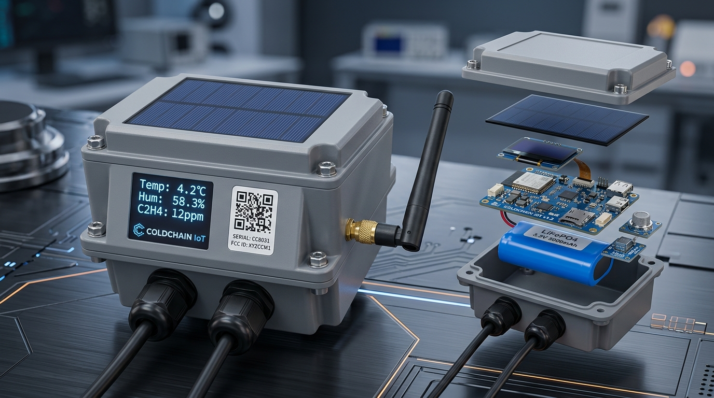

# ColdChain IoT™ — Interactive 3D Hardware Showcase

An interactive 3D WebGL / Three.js digital twin of the **ColdChain IoT Monitoring Device** (Prototype V2), engineered from the physical prototype and system architecture specifications.



---

## 🚀 Quick Start (Running Locally)

You can launch the showcase immediately without installing any external build tools or node modules:

### Option 1: Double-Click
Simply open `index.html` in any modern web browser (Google Chrome, Microsoft Edge, Brave, Firefox).

### Option 2: Local HTTP Server (PowerShell)
Right-click `server.ps1` and select **"Run with PowerShell"**, or execute in terminal:
```powershell
powershell -ExecutionPolicy Bypass -File ./server.ps1
```
This automatically hosts the application at `http://localhost:8080/index.html` and opens your default browser.

---

## 🌟 Interactive Showcase Features

* 🔄 **360° Free Orbit & Smooth Zoom:** Cinematic orbit camera with studio lighting, realistic shadows, and PBR shaders.
* 💥 **Interactive Exploded Assembly View:** Smooth slider and toggle that lifts the solar panel, screws, lid, neoprene IP67 gasket, modular PCBs, and battery pack in 3D space.
* 📟 **Live OLED Display Simulation:** The front 0.96" OLED screen is driven by a real-time dynamic HTML5 canvas that live-renders simulated temperature, humidity, ethylene (C₂H₄) gas, battery gauge, and blockchain block proof.
* 🏷️ **9 Interactive 3D Hotspot Pins:** Click on any numbered pin to inspect hardware specifications, pinouts, and subsystem functions in the side inspector.
* 🎥 **One-Click 360° Video Recording:** Built-in video exporter captures a 60 FPS video clip of the rotating 3D hardware assembly directly to your downloads.
* 📸 **4K Snapshot Capture:** Generates instant high-resolution PNG renders.
* 🔬 **Multiple Visual Modes:**
  * **Photorealistic:** Assembled rugged IP67 enclosure, brushed aluminum solar bezel, chrome hex bolts, and ENIG gold PCB contacts.
  * **Exploded View:** Full layer breakdown with component separation.
  * **X-Ray Internal View:** Translucent cyber-cyan casing exposing internal modular electronics and battery pack.
  * **CAD Blueprint:** Technical engineering wireframe overlay.
* 🔊 **Synthesized Web Audio SFX:** Tactile audio clicks and mechanical servo feedback synthesized natively without external audio files.

---

## 🛠️ Hardware Subsystem Architecture

| # | Subsystem | Component / IC | Cold-Chain Function |
|---|---|---|---|
| **1** | Energy Harvesting | Monocrystalline ETFE Solar Panel | 1.75W outdoor solar recharge for perpetual autonomy |
| **2** | Visual HMI Display | 0.96" Dual-Color OLED (SSD1306) | Instant on-site validation of temp, humidity, and C₂H₄ |
| **3** | Edge IoT Controller | ESP32-S3-WROOM-1 (Xtensa LX7) | 240MHz dual-core compute, local anomaly detection, Wi-Fi/BLE |
| **4** | Cryptographic Storage | Non-Volatile FRAM & ATECC608A | 100 trillion cycle endurance, tamper-evident AES-256 ledger sign |
| **5** | Power Management | Synchronous MPPT Buck-Boost | Dynamic solar tracking, cold-temperature LiFePO4 charging |
| **6** | Energy Storage | LiFePO4 3.2V 6000mAh Battery Pack | Sub-zero temperature resilience (-25°C to +65°C), zero fire risk |
| **7** | Wireless Connectivity | 4G/LTE-M & LoRa Dipole Antenna | Long-range cellular + LoRaWAN with automatic store-and-forward |
| **8** | Rugged Packaging | IP67 Polycarbonate Enclosure | Dust, water immersion, and IK08 shock/vibration resistant |
| **9** | Environmental Sensors | SHT31, MQ-138, MPU6050, GPS | Temp, humidity, ethylene ripening gas, cargo shock, GPS tracking |
